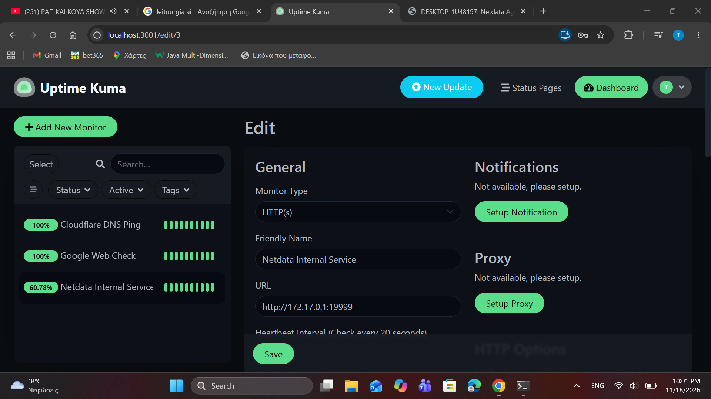
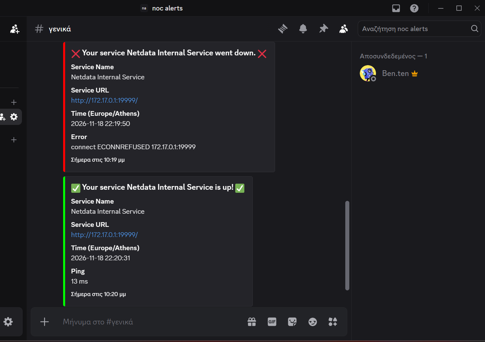
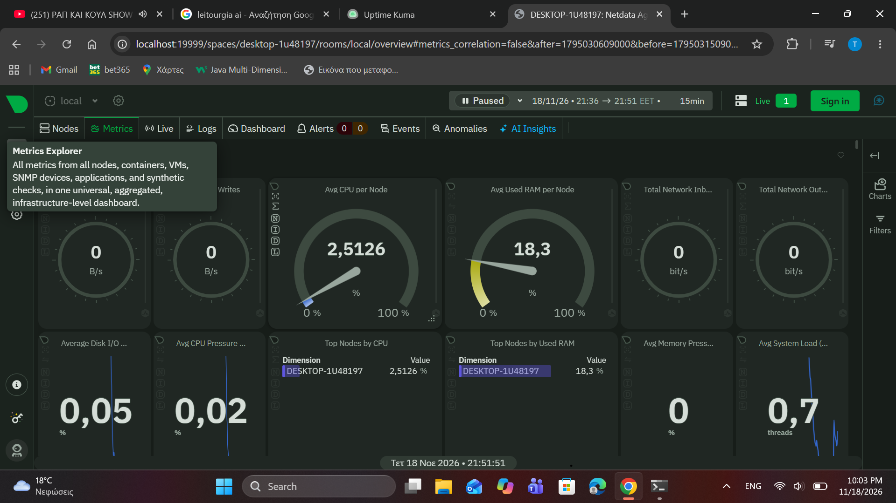
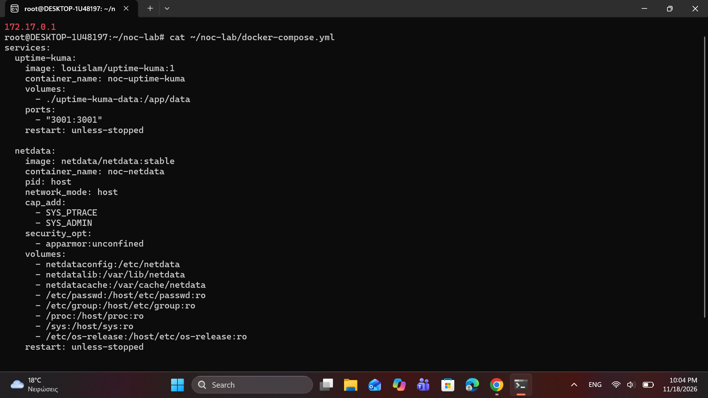

# NOC Infrastructure & Network Monitoring Lab

A containerized Network Operations Center (NOC) monitoring and alerting environment deployed on Ubuntu Linux using Docker Compose. This project demonstrates real-world service availability checks, system metrics analysis, automated incident alerting, and network troubleshooting.

## Architecture & Tools
* **OS:** Ubuntu Linux (WSL2 / Desktop)
* **Containerization:** Docker & Docker Compose
* **Service & Network Monitoring:** Uptime Kuma (HTTP/HTTPS, ICMP Ping, Docker Container health checks)
* **Real-Time System Metrics:** Netdata (CPU, RAM, Disk I/O, Network traffic)
* **Incident Alerting:** Automated real-time webhook notifications integrated with Discord

## Key Features & Troubleshooting
* **Infrastructure as Code:** Automated multi-container deployment via `docker-compose.yml`.
* **24/7 Monitoring Checks:** Configured 20-second heartbeat intervals tracking external web endpoints (`HTTPS`), DNS latency (`ICMP Ping`), and internal containerized services.
* **Docker Networking Troubleshooting:** Diagnosed and resolved container-to-host communication errors (`ECONNREFUSED`) by routing internal monitoring traffic through the Docker bridge interface (`172.17.0.1`).
* **Incident Response Simulation:** Executed controlled service outages (`docker stop/start`), verified real-time Down/Up Discord webhook alerts, and analyzed recovery uptime metrics.

## Project Screenshots

### 1. Uptime Kuma NOC Dashboard

### 2. Automated Incident Alerting (Discord Webhooks)

### 3. Netdata Real-Time System Metrics

### 4. Docker Containers Deployment (Linux Terminal)

